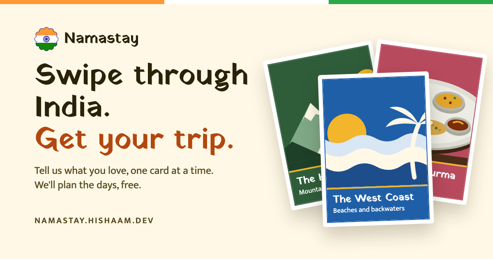

<!-- markdownlint-disable MD033 -->

<p align="center">
  
</p>

## Namastay

Namastay is a free trip planner for first-time visitors to India. Swipe through places, food and experiences, and it turns what you like into a day-by-day itinerary.

**Live at [namastay.hishaam.dev](https://namastay.hishaam.dev)**

## What It Does

- Learns your taste from a swipe journey, then builds a realistic route that lands and flies home from a major city
- Writes honest guides to 68 places, with what to see, when to go, how to get there and where to stay
- Shows what to eat in each region, and where people go for it
- Saves and edits trips for signed-in visitors, with a share link for each one
- Gives every public page real HTML, structured data and a share image, so search engines and link previews read it properly

## Tech Stack

[](https://fsharp.org/)
[](https://dotnet.microsoft.com/)
[](https://learn.microsoft.com/aspnet/core/fundamentals/minimal-apis)
[](https://fable.io/)
[](https://react.dev/)
[](https://vite.dev/)
[](https://www.postgresql.org/)
[](https://playwright.dev/)
[](https://railway.com/)

## Quick Start

You need the .NET 10 SDK, Node and Docker.

```bash
make setup
make up
make sample
```

Then run these in two terminals:

```bash
make dev
```

```bash
make client
```

Open [http://localhost:5173](http://localhost:5173). `make sample` loads a small invented catalogue, because the real travel data is private and reaches visitors only through the API.

## How It's Built

| Project | What it holds |
| --- | --- |
| `src/Namastay.Shared` | Contracts and typed routes, compiled for both the server and the browser |
| `src/Namastay.Domain` | Pure rules: scoring, routing and building trips |
| `src/Namastay.Data` | SQL, migrations and the import |
| `src/Namastay.Web` | The API and guide pages. Start at `Program.fs` |
| `src/Namastay.Client` | The website, F# compiled to JavaScript. Start at `App.fs` |
| `src/Namastay.Importer` | Loads data into Postgres and photos into the bucket |

The API stands alone at its own address, so the website and any future native app use it the same way. More in [docs/architecture.md](docs/architecture.md).

## Common Commands

```bash
make test-all    # unit, integration and browser tests
make check-all   # the above, plus format, lint and coverage
make import      # load data/ into Postgres
make media-sync  # upload data/media to the bucket
make down        # stop Postgres and the photo store
```

## Docs

- [Architecture](docs/architecture.md)
- [Data format](docs/data-format.md)
- [Deploying](docs/deploy.md)

## License

[GPL-3.0](LICENSE). This covers the code. The travel data and photos aren't part of this repository.
